<div align="center">



</div>

### `layer:01` — identity

i build systems from zero to production: crm, e-commerce, saas.
architecture, backend, frontend, deploy — and the team around it.
currently leading the build of an e-commerce ecosystem. based in bishkek, open to remote.

### `layer:02` — the wired

<div align="center">



</div>

> every node is commercial and private. ask for a walkthrough — i'll open the connection.

### `layer:03` — protocol

```text
backend   java 21 · spring boot · spring security · hibernate · keycloak · jwt
data      postgresql · redis · flyway
infra     docker · github actions · caddy · linux
tests     junit · mockito · testcontainers
front     react · typescript
```

### `layer:04` — connect

<p>
<a href="https://www.linkedin.com/in/suleimanovamir/"></a>
<a href="https://t.me/suleimanovdev"></a>
<a href="mailto:suleimanovamirbk@gmail.com"></a>
</p>

<div align="center">



</div>
