<div align="center">

```
╔══════════════════════════════════════════════════════════════════════╗
║                                                                      ║
║       "He who controls the code, controls the world."                ║
║                        — Zero Algorithm                              ║
║                                                                      ║
╚══════════════════════════════════════════════════════════════════════╝
```


# **Sotonu** — Full-Stack Developer

*"Code is the Geass I cast upon reality."*

  

[](https://t.me/suleimanovdev)
[](mailto:suleimanovamirbk@gmail.com)

</div>

---

## 🜁 Philosophy — The Path of the Developer

```javascript
const Sotonu = {
    name: "Sotonu",
    role: "Java Backend / Full-Stack Developer",
    philosophy: "Building scalable, secure systems that matter"
};
```

> *"From hackathons to production — every challenge shapes the developer."*  
> — **Sotonu's Journey**

---

## 🜁 Tech Arsenal

<div align="center">

### Backend


### Frontend


### Security & Auth


### Databases & Tools


</div>

---

## 🜁 What I Do — Fields of Command

<div align="center">

### 🎯 Tech Expertise

<table>
<tr>
<td align="center" width="33%">

<br><b>Backend Engineering</b>
<br>Spring Boot • Security
<br>Keycloak • JWT • OAuth2
</td>
<td align="center" width="33%">

<br><b>Full-Stack Development</b>
<br>React • REST API
<br>Microservices Architecture
</td>
<td align="center" width="33%">

<br><b>System Design</b>
<br>PostgreSQL • MySQL
<br>Scalability • Performance
</td>
</tr>
</table>

### 🏆 Real Experience

**🏢 Production Systems:** Unicorn Soft (10k+ users), PRODUMANO (B2B platform), JS-SOFT (medical web)  
**👥 Team Leadership:** Led teams of 4-7 developers in hackathons and startups  
**🎖️ Hackathons:** IT FEST 2024 Team Leader, DT4CE Java Developer (certified)  
**🚀 Projects:** Financial transactions, AI integration, traffic analysis systems

</div>

---

## 🜁 The Contract — Command Center

<div align="center">



</div>

---

## 🜁 Zero Requiem — Play Chess Against Zero

<div align="center">

*"If the King doesn't lead, how can he expect his subordinates to follow?"*

</div>

<!-- ZERO-CHESS:START -->

<div align="center">


</div>

**You play White. Pick a move and Zero will answer.**

**♙ Pawn** — [a3](https://github.com/Sotonush/sotonush/issues/new?title=chess%7Cmove%7Ca2a3&body=Just%20press%20%2A%2ASubmit%20new%20issue%2A%2A.%20Zero%20answers%20in%20about%20a%20minute%20and%20the%20board%20in%20the%20profile%20updates.) · [a4](https://github.com/Sotonush/sotonush/issues/new?title=chess%7Cmove%7Ca2a4&body=Just%20press%20%2A%2ASubmit%20new%20issue%2A%2A.%20Zero%20answers%20in%20about%20a%20minute%20and%20the%20board%20in%20the%20profile%20updates.) · [b3](https://github.com/Sotonush/sotonush/issues/new?title=chess%7Cmove%7Cb2b3&body=Just%20press%20%2A%2ASubmit%20new%20issue%2A%2A.%20Zero%20answers%20in%20about%20a%20minute%20and%20the%20board%20in%20the%20profile%20updates.) · [b4](https://github.com/Sotonush/sotonush/issues/new?title=chess%7Cmove%7Cb2b4&body=Just%20press%20%2A%2ASubmit%20new%20issue%2A%2A.%20Zero%20answers%20in%20about%20a%20minute%20and%20the%20board%20in%20the%20profile%20updates.) · [c3](https://github.com/Sotonush/sotonush/issues/new?title=chess%7Cmove%7Cc2c3&body=Just%20press%20%2A%2ASubmit%20new%20issue%2A%2A.%20Zero%20answers%20in%20about%20a%20minute%20and%20the%20board%20in%20the%20profile%20updates.) · [c4](https://github.com/Sotonush/sotonush/issues/new?title=chess%7Cmove%7Cc2c4&body=Just%20press%20%2A%2ASubmit%20new%20issue%2A%2A.%20Zero%20answers%20in%20about%20a%20minute%20and%20the%20board%20in%20the%20profile%20updates.) · [d3](https://github.com/Sotonush/sotonush/issues/new?title=chess%7Cmove%7Cd2d3&body=Just%20press%20%2A%2ASubmit%20new%20issue%2A%2A.%20Zero%20answers%20in%20about%20a%20minute%20and%20the%20board%20in%20the%20profile%20updates.) · [d4](https://github.com/Sotonush/sotonush/issues/new?title=chess%7Cmove%7Cd2d4&body=Just%20press%20%2A%2ASubmit%20new%20issue%2A%2A.%20Zero%20answers%20in%20about%20a%20minute%20and%20the%20board%20in%20the%20profile%20updates.) · [e5](https://github.com/Sotonush/sotonush/issues/new?title=chess%7Cmove%7Ce4e5&body=Just%20press%20%2A%2ASubmit%20new%20issue%2A%2A.%20Zero%20answers%20in%20about%20a%20minute%20and%20the%20board%20in%20the%20profile%20updates.) · [f3](https://github.com/Sotonush/sotonush/issues/new?title=chess%7Cmove%7Cf2f3&body=Just%20press%20%2A%2ASubmit%20new%20issue%2A%2A.%20Zero%20answers%20in%20about%20a%20minute%20and%20the%20board%20in%20the%20profile%20updates.) · [f4](https://github.com/Sotonush/sotonush/issues/new?title=chess%7Cmove%7Cf2f4&body=Just%20press%20%2A%2ASubmit%20new%20issue%2A%2A.%20Zero%20answers%20in%20about%20a%20minute%20and%20the%20board%20in%20the%20profile%20updates.) · [g3](https://github.com/Sotonush/sotonush/issues/new?title=chess%7Cmove%7Cg2g3&body=Just%20press%20%2A%2ASubmit%20new%20issue%2A%2A.%20Zero%20answers%20in%20about%20a%20minute%20and%20the%20board%20in%20the%20profile%20updates.) · [g4](https://github.com/Sotonush/sotonush/issues/new?title=chess%7Cmove%7Cg2g4&body=Just%20press%20%2A%2ASubmit%20new%20issue%2A%2A.%20Zero%20answers%20in%20about%20a%20minute%20and%20the%20board%20in%20the%20profile%20updates.) · [h3](https://github.com/Sotonush/sotonush/issues/new?title=chess%7Cmove%7Ch2h3&body=Just%20press%20%2A%2ASubmit%20new%20issue%2A%2A.%20Zero%20answers%20in%20about%20a%20minute%20and%20the%20board%20in%20the%20profile%20updates.) · [h4](https://github.com/Sotonush/sotonush/issues/new?title=chess%7Cmove%7Ch2h4&body=Just%20press%20%2A%2ASubmit%20new%20issue%2A%2A.%20Zero%20answers%20in%20about%20a%20minute%20and%20the%20board%20in%20the%20profile%20updates.)  
**♘ Knight** — [Na3](https://github.com/Sotonush/sotonush/issues/new?title=chess%7Cmove%7Cb1a3&body=Just%20press%20%2A%2ASubmit%20new%20issue%2A%2A.%20Zero%20answers%20in%20about%20a%20minute%20and%20the%20board%20in%20the%20profile%20updates.) · [Nc3](https://github.com/Sotonush/sotonush/issues/new?title=chess%7Cmove%7Cb1c3&body=Just%20press%20%2A%2ASubmit%20new%20issue%2A%2A.%20Zero%20answers%20in%20about%20a%20minute%20and%20the%20board%20in%20the%20profile%20updates.) · [Ne2](https://github.com/Sotonush/sotonush/issues/new?title=chess%7Cmove%7Cg1e2&body=Just%20press%20%2A%2ASubmit%20new%20issue%2A%2A.%20Zero%20answers%20in%20about%20a%20minute%20and%20the%20board%20in%20the%20profile%20updates.) · [Nf3](https://github.com/Sotonush/sotonush/issues/new?title=chess%7Cmove%7Cg1f3&body=Just%20press%20%2A%2ASubmit%20new%20issue%2A%2A.%20Zero%20answers%20in%20about%20a%20minute%20and%20the%20board%20in%20the%20profile%20updates.) · [Nh3](https://github.com/Sotonush/sotonush/issues/new?title=chess%7Cmove%7Cg1h3&body=Just%20press%20%2A%2ASubmit%20new%20issue%2A%2A.%20Zero%20answers%20in%20about%20a%20minute%20and%20the%20board%20in%20the%20profile%20updates.)  
**♗ Bishop** — [Ba6](https://github.com/Sotonush/sotonush/issues/new?title=chess%7Cmove%7Cf1a6&body=Just%20press%20%2A%2ASubmit%20new%20issue%2A%2A.%20Zero%20answers%20in%20about%20a%20minute%20and%20the%20board%20in%20the%20profile%20updates.) · [Bb5](https://github.com/Sotonush/sotonush/issues/new?title=chess%7Cmove%7Cf1b5&body=Just%20press%20%2A%2ASubmit%20new%20issue%2A%2A.%20Zero%20answers%20in%20about%20a%20minute%20and%20the%20board%20in%20the%20profile%20updates.) · [Bc4](https://github.com/Sotonush/sotonush/issues/new?title=chess%7Cmove%7Cf1c4&body=Just%20press%20%2A%2ASubmit%20new%20issue%2A%2A.%20Zero%20answers%20in%20about%20a%20minute%20and%20the%20board%20in%20the%20profile%20updates.) · [Bd3](https://github.com/Sotonush/sotonush/issues/new?title=chess%7Cmove%7Cf1d3&body=Just%20press%20%2A%2ASubmit%20new%20issue%2A%2A.%20Zero%20answers%20in%20about%20a%20minute%20and%20the%20board%20in%20the%20profile%20updates.) · [Be2](https://github.com/Sotonush/sotonush/issues/new?title=chess%7Cmove%7Cf1e2&body=Just%20press%20%2A%2ASubmit%20new%20issue%2A%2A.%20Zero%20answers%20in%20about%20a%20minute%20and%20the%20board%20in%20the%20profile%20updates.)  
**♕ Queen** — [Qe2](https://github.com/Sotonush/sotonush/issues/new?title=chess%7Cmove%7Cd1e2&body=Just%20press%20%2A%2ASubmit%20new%20issue%2A%2A.%20Zero%20answers%20in%20about%20a%20minute%20and%20the%20board%20in%20the%20profile%20updates.) · [Qf3](https://github.com/Sotonush/sotonush/issues/new?title=chess%7Cmove%7Cd1f3&body=Just%20press%20%2A%2ASubmit%20new%20issue%2A%2A.%20Zero%20answers%20in%20about%20a%20minute%20and%20the%20board%20in%20the%20profile%20updates.) · [Qg4](https://github.com/Sotonush/sotonush/issues/new?title=chess%7Cmove%7Cd1g4&body=Just%20press%20%2A%2ASubmit%20new%20issue%2A%2A.%20Zero%20answers%20in%20about%20a%20minute%20and%20the%20board%20in%20the%20profile%20updates.) · [Qh5](https://github.com/Sotonush/sotonush/issues/new?title=chess%7Cmove%7Cd1h5&body=Just%20press%20%2A%2ASubmit%20new%20issue%2A%2A.%20Zero%20answers%20in%20about%20a%20minute%20and%20the%20board%20in%20the%20profile%20updates.)  
**♔ King** — [Ke2](https://github.com/Sotonush/sotonush/issues/new?title=chess%7Cmove%7Ce1e2&body=Just%20press%20%2A%2ASubmit%20new%20issue%2A%2A.%20Zero%20answers%20in%20about%20a%20minute%20and%20the%20board%20in%20the%20profile%20updates.)  

<sub>Last moves: `1. e4` @Sotonush · `1… Nf6` Zero</sub>

<sub>Knights of the board: @Sotonush (1)</sub>

<!-- ZERO-CHESS:END -->

---

## 🜁 Values — The Black Knights Codex

<div align="center">

🜄 **Elegance in code** • 🜁 **Global collaboration** • 🜂 **Rapid iteration**  
🜃 **Beauty through architecture** • 🜀 **Knowledge above all**

</div>

---

## 🜁 Contact — Speak Your Will

<div align="center">

**Open to alliances, ideas, and ambitious projects.**  
If your vision is bold — I'm listening.

```
"Those who dare to code the future… become its authors."
```


---

*Forged with will · Guided by logic · Powered by Geass*


</div>
