<div align="center">



<br/>

[](https://t.me/suleimanovdev)
[](mailto:suleimanovamirbk@gmail.com)


</div>

<br/>

```java
var sotonu = Developer.builder()
        .role("Java Backend / Full-Stack Engineer")
        .from("Kyrgyzstan 🇰🇬")
        .loves(List.of("clean architecture", "secure systems", "shipping fast"))
        .motto("Code is the Geass I cast upon reality.")
        .build();
```

## ⟡ Arsenal

<div align="center">


<br/>


</div>

<table>
<tr>
<td width="33%" valign="top">

**⚙️ Backend**<br/>
Spring Boot · Spring Security<br/>
JWT · OAuth2 · Keycloak<br/>
REST · OpenAPI · Flyway

</td>
<td width="33%" valign="top">

**🗄 Data & Infra**<br/>
PostgreSQL · MySQL · Redis<br/>
Docker · CI/CD · Linux<br/>
S3 · Testcontainers

</td>
<td width="33%" valign="top">

**🖥 Frontend**<br/>
React · TypeScript<br/>
REST clients · SPA<br/>
HTML · CSS

</td>
</tr>
</table>

## ⟡ Contributions

<div align="center">


</div>

---

<div align="center">


*"Those who dare to code the future… become its authors."*

<sub>Forged with will · Guided by logic · Powered by Geass</sub>

</div>
